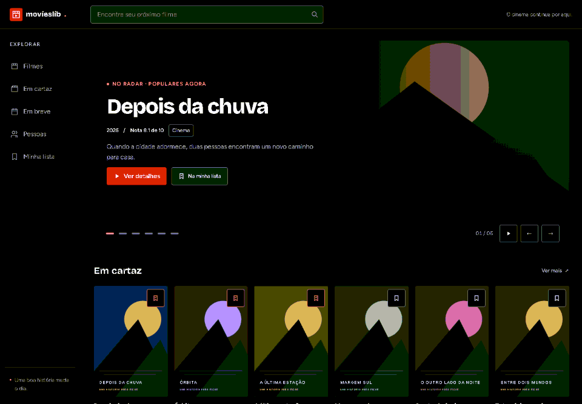
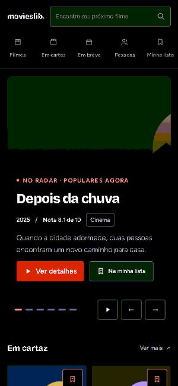

# MoviesLib

Projeto de estudo e portfólio feito por **Guilherme Zalla**, sem vínculo ou endosso do The Movie Database (TMDB) ou dos estúdios citados. Código sob [licença MIT](LICENSE); fontes, imagens e atribuições em [CREDITS.md](CREDITS.md).

Um catálogo para descobrir o próximo filme, conhecer quem está por trás dele e guardar o que você quer assistir. Reúne populares, filmes em cartaz e em breve, busca, filtros, trailers e filmografias, com interface em **português do Brasil e inglês**.

O visual tem tema escuro, pôsteres em destaque e uma abertura que apresenta os filmes populares automaticamente. Funciona no computador e no celular, sem cadastro.

[Repositório do projeto](https://github.com/GuilhermeZalla/react-movieslib). A publicação ainda está pendente.

## Demonstrações

Capturas do site funcionando com os **dados, pôsteres e fotos reais carregados pelo TMDB**, atualizadas em **30/10/2026**. Os filmes em destaque e a ordem do catálogo podem mudar com o tempo.

### Desktop



### Celular



## Screenshots

As mesmas telas da aplicação, em português: desktop em **1440 × 1000** e celular em **390 × 844**.

| Tela                 | Desktop                                                 | Celular                                                |
| -------------------- | ------------------------------------------------------- | ------------------------------------------------------ |
| Home                 | [Ver captura](docs/screenshots/home-desktop.png)        | [Ver captura](docs/screenshots/home-mobile.png)        |
| Catálogo e filtros   | [Ver captura](docs/screenshots/catalogo-desktop.png)    | [Ver captura](docs/screenshots/catalogo-mobile.png)    |
| Filme                | [Ver captura](docs/screenshots/filme-desktop.png)       | [Ver captura](docs/screenshots/filme-mobile.png)       |
| Pessoas              | [Ver captura](docs/screenshots/pessoas-desktop.png)     | [Ver captura](docs/screenshots/pessoas-mobile.png)     |
| Pessoa e filmografia | [Ver captura](docs/screenshots/pessoa-desktop.png)      | [Ver captura](docs/screenshots/pessoa-mobile.png)      |
| Minha lista          | [Ver captura](docs/screenshots/minha-lista-desktop.png) | [Ver captura](docs/screenshots/minha-lista-mobile.png) |

## Funcionalidades

- **Descobrir filmes:** populares, em cartaz, em breve e mais bem avaliados.
- **Buscar e filtrar:** pesquisa por título, gênero, ano, nota e ordenação, com navegação entre páginas.
- **Explorar os detalhes:** sinopse, nota, ficha do filme, elenco, equipe, imagens e recomendações.
- **Assistir ao trailer:** o player só carrega ao clicar; há também um link para abrir no YouTube.
- **Conhecer as pessoas:** busca, biografias e filmografias de atores e profissionais do cinema.
- **Guardar para depois:** Minha lista mantém os filmes escolhidos neste navegador, sem precisar de conta.
- **Escolher o idioma:** português do Brasil ou inglês pelo seletor no rodapé.

## Estrutura e stack

Interface em **React 18, TypeScript e Tailwind CSS**, com Vite. Os dados vêm do TMDB por um proxy na Vercel; TanStack Query cuida das consultas e Zod confere as respostas.

- `src/`: telas, componentes e navegação.
- `api/`, `server/` e `shared/`: conexão protegida com o TMDB.
- `e2e/` e testes em `src/` e `server/`: verificações do projeto.
- `docs/`: decisões, orientações e mídias.

## Executar localmente

Requisitos: **Node.js 24.15.0**, **npm 11.12.1** e um **Token de Leitura da API do TMDB**. A chave de API separada não é necessária.

Para uma primeira instalação, na raiz do projeto, em PowerShell:

```powershell
npm.cmd ci
if (!(Test-Path .env.local)) { Copy-Item .env.example .env.local }
```

Abra `.env.local` no seu editor e preencha `TMDB_READ_ACCESS_TOKEN` com o token de leitura. Ele fica apenas no servidor: não use prefixo `VITE_` nem versione esse arquivo.

Depois, inicie o site:

```powershell
npm.cmd run dev
```

Acesse **http://127.0.0.1:5173**. Se o projeto já estiver configurado, basta esse último comando; preserve seu `.env.local`. Para encerrar, use `Ctrl+C`. No macOS/Linux, use `npm` no lugar de `npm.cmd`.

Configuração na Vercel, uso de `vercel dev` e detalhes do proxy estão no [guia de operação](docs/OPERACAO.md).

## Fluxo de demonstração

1. Na home, aguarde a troca automática do destaque e explore os filmes em cartaz.
2. Abra o catálogo, busque um filme e experimente os filtros.
3. Entre em um filme, confira os detalhes e abra o trailer.
4. Guarde um filme e encontre-o em **Minha lista**.
5. Explore **Pessoas**, abra uma filmografia e troque o idioma no rodapé.

## Verificações

```powershell
npm.cmd run check
npm.cmd exec playwright install chromium
npm.cmd run test:e2e -- --reporter=line
```

O primeiro comando confere código, tipos, testes e build. Os testes de navegador percorrem as telas com dados de teste, sem depender do TMDB. A captura das mídias do README usa o site real e pode ser refeita com `npm.cmd run docs:media`; veja as [instruções](docs/OPERACAO.md#atualizar-fotos-e-gifs).

## Limites do projeto

- Não oferece filmes completos: o player é apenas para trailers.
- Minha lista fica neste navegador, sem sincronização entre dispositivos; limpar os dados do site apaga os filmes guardados.
- Ao buscar por título, os filtros refinam apenas a página de resultados recebida. Sem busca por título, os filtros consultam o catálogo completo.
- Algumas sinopses ou biografias podem não ter tradução no TMDB. A disponibilidade de trailers também depende do YouTube.

## Documentação

- [Configuração e operação](docs/OPERACAO.md): ambiente, proxy, Vercel, testes e atualização das mídias.
- [Status do projeto](docs/STATUS.md): decisões e próximos passos.
- [Design](docs/DESIGN.md): identidade visual.
- [Dependências](docs/DEPENDENCIES.md): versões e histórico técnico.
- [Créditos e licenças](CREDITS.md): fontes e materiais de terceiros.
